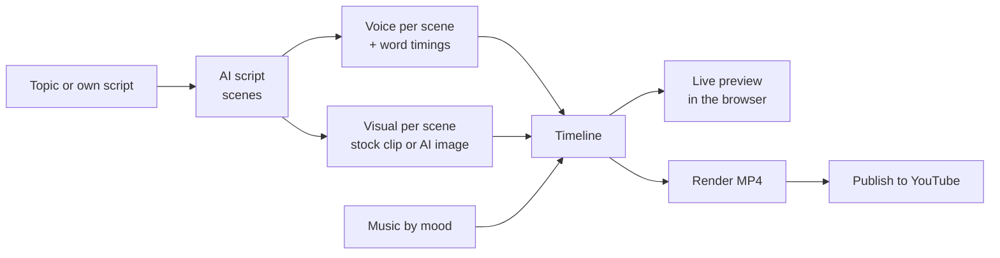
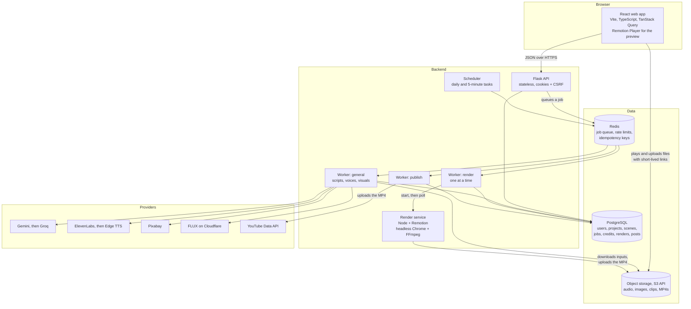
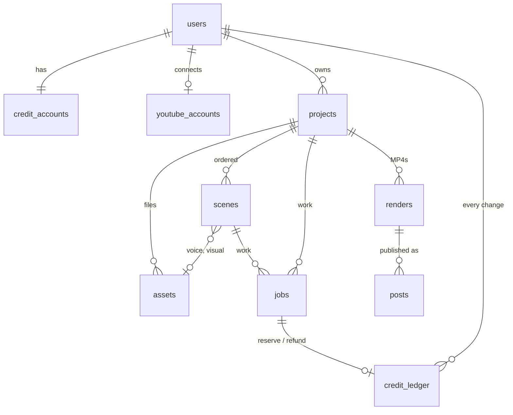
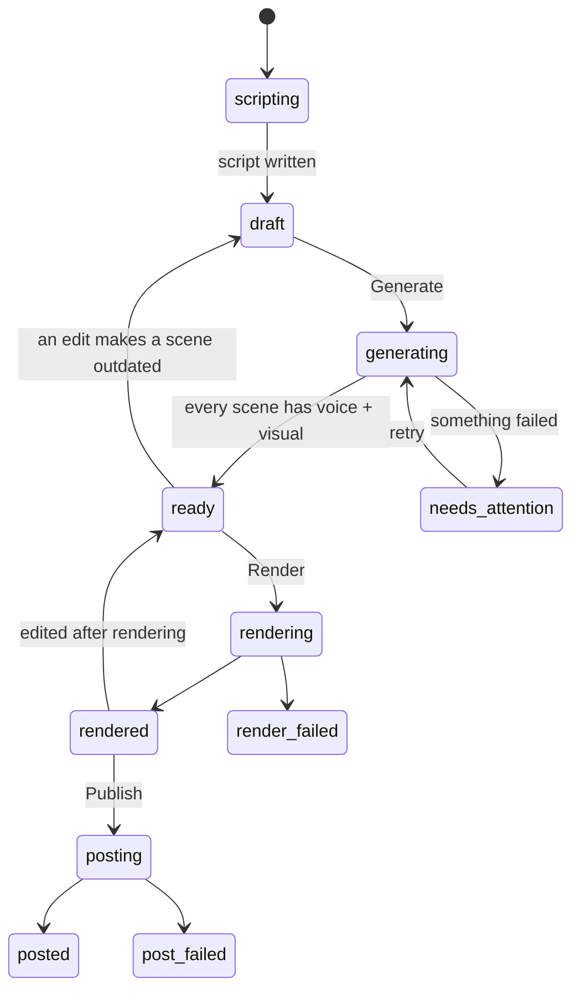
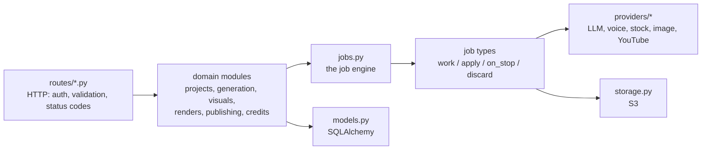

# ReelForge: architecture, and why it is built this way

This is the one document to read to understand the whole system. It describes what was **built**, with the reason for each choice. The detailed designs are in [TECHNICAL_DESIGN.md](TECHNICAL_DESIGN.md), [API_DESIGN.md](API_DESIGN.md) and [DB_DESIGN.md](DB_DESIGN.md).

## 1. What the product does

A creator types a topic. ReelForge writes a script, makes a voiceover, finds or generates visuals, adds music and captions, shows a live preview, renders a vertical MP4 (up to 90 seconds) and publishes it as a YouTube Short.



## 2. The system at a glance



**The parts and what each is responsible for:**

| Part | Technology | It owns | It never does |
|---|---|---|---|
| Web app | React 18, TypeScript, Vite, Tailwind, TanStack Query | Screens, autosave, the live preview | Talk to providers; hold secrets |
| API | Flask 3, SQLAlchemy 2, Pydantic | Auth, validation, credits, starting jobs, signed file links | Slow work: every request answers in milliseconds |
| Workers | Celery 5 on Redis | Every slow or failing thing: AI calls, downloads, rendering, uploading | Serve HTTP |
| Render service | Node, Remotion, Chrome, FFmpeg | Turning one timeline into one MP4 | Touch the database or hold storage keys |
| PostgreSQL | v16 | The truth: every row that matters | |
| Redis | v7 | The job queue; rate limits; idempotency keys (data that may be lost) | Anything that must survive |
| Object storage | S3 API (MinIO locally) | Every file | |

## 3. The eight decisions that shape everything

### 3.1 Slow work never happens in a web request: jobs

A script takes 5 to 20 seconds, a voice 3 to 10, a render many minutes. An HTTP request that waits that long ties up a server process, times out at proxies and can't show progress.

So every slow action is a **job**: the request writes a `jobs` row (state `queued`), reserves the credits and answers `202` at once. A worker picks it up; the browser polls the job every 2 seconds.

```mermaid
sequenceDiagram
    participant W as Web app
    participant A as API
    participant DB as PostgreSQL
    participant Q as Redis queue
    participant K as Worker
    participant P as Provider
    W->>A: POST /scenes/42/voice
    A->>DB: lock project; create job (queued); reserve 1 credit
    A->>Q: enqueue job id (after the commit)
    A-->>W: 202 {job}
    K->>Q: take job
    K->>DB: job = running
    K->>P: make the audio (no database lock held)
    P-->>K: audio + word timings
    K->>DB: lock again. Still running? save file, scene.voice = ready, job = succeeded
    W->>A: GET /jobs/id (every 2 s)
    A-->>W: succeeded
```

Three rules make this safe:

- **Do the slow part without locks, then lock and re-check.** If the job was cancelled or the scene edited meanwhile, the result is thrown away (and its file deleted).
- **A job may run twice** (Celery re-delivers after a crash), so it first checks that it is still `queued`.
- **Every failure ends the job**: failed with a plain-language reason, credits refunded. A sweeper task fails jobs that stay "running" past their limit.

### 3.2 Providers are replaceable, with a fallback chain

AI services change prices, retire models and go down. Each kind of work has a small interface (`generate_json`, `synthesize`, `search`), several implementations, and an order: Gemini then Groq; ElevenLabs then Edge TTS.

- A **mock** implementation of each makes the whole test suite run offline, with no keys and no cost. Production refuses to start with a mock configured.
- An admin **kill switch** per provider skips a broken one without a deploy.

During the project this paid off twice: two model versions were retired, and one stock provider stopped issuing keys. Each fix was a few lines.

### 3.3 The timeline is the contract

One JSON document describes the whole video: scenes with their start frame and length, the visual, the voice and its word timings, the music and volumes.

- The **editor preview** plays it in the browser with the Remotion Player.
- The **renderer** draws the same document with the same React components, so what you preview is what you get. A test fails the build if the browser's copy of those components differs from the renderer's.
- A **render** stores the exact timeline it used. Edits after that make the render "outdated", never wrong.

### 3.4 Credits are a ledger, reserved before the work

Every AI action costs credits. The rules are those of a bank:

- The balance changes only together with a **ledger row** (`grant`, `reserve`, `refund`, `adjust`), in one transaction.
- Credits are **reserved when the job is created**, all or nothing for a batch, with the account row locked. Two requests at once can't both spend the last credit. (A QA review found exactly this race in an early version; the lock fixed it.)
- A failed or cancelled job **refunds** itself; the database allows one refund per job, so a refund can't happen twice.

### 3.5 Files never pass through the API

Videos are large. The API hands out **presigned links**: short-lived URLs that let the browser, or the render service, read or write one file directly in storage. The API stays small and stateless, and the render service needs no storage credentials.

### 3.6 The render service is separate

Rendering needs headless Chrome and FFmpeg (a 1.5 GB image) and a lot of CPU for minutes. Keeping it out of the Python image means:

- the API and workers stay small and start fast;
- rendering scales on its own (more render instances, or Remotion Lambda later);
- a crash in Chrome can't take the API down.

The render **worker** only starts a render and polls it, so it sits idle most of the time. It has its own queue, so a 30-minute render never delays a 5-second script.

### 3.7 Security by default

- **Sessions:** a short-lived access token (15 minutes) and a rotating refresh token, both in `HttpOnly` cookies. JavaScript can't read them, so an XSS bug can't steal a session.
- **CSRF:** every change needs a header that only our own pages can produce.
- **Passwords:** Argon2id; common passwords refused.
- **OAuth (YouTube):** a random, single-use `state` tied to the signed-in user; the return address can only be a path on our own site; the tokens are stored encrypted.
- **Rate limits** per IP and per user, in Redis.
- **Idempotency keys** on the expensive actions (generate, render, publish): a retried click never charges twice.
- **Production refuses unsafe settings**: default secrets, mock providers, plain-HTTP origins.

### 3.8 Quality as a process

Every milestone went through two reviews before it was committed: a **Tester** role (writes automated tests, reports bugs with steps) and a **QA** role (reads the code against the documents). Their findings and the fixes are in `docs/qa/`. The result: about 1,700 backend tests, 730 frontend unit tests and 200 browser tests, all run by CI on every push.

## 4. Data model (the tables that matter)



A project moves through these statuses:



## 5. The request path, layer by layer



Each job type implements the same four steps, which is why adding rendering and publishing later needed no change to the engine:

| Step | When | Holds a lock? |
|---|---|---|
| `work(job)` | The slow part (provider call) | No |
| `apply(job, result)` | Saving the result, in the transaction that marks the job done | Yes |
| `on_stop(job)` | Undoing the job's effect when it fails or is cancelled | Yes |
| `discard(job, result)` | Deleting what was made but not kept | No |

## 6. Running it

- **Locally:** one `docker compose up` starts 9 containers: Postgres, Redis, MinIO, a test mailbox, the API, three workers, the scheduler (inside the general worker) and the render service.
- **Tests:** the suite runs inside the API container against a separate test database, with every provider mocked.
- **CI (GitHub Actions):** builds the stack, lints, runs the tests, and checks that the production image refuses development secrets.
- **Deployment options** are compared in [DEPLOYMENT_OPTIONS.md](DEPLOYMENT_OPTIONS.md).

## 7. What I would do differently, or next

- **Render speed.** Software rendering of 1080×1920 video is slow on small machines (about 1 frame a second on a laptop). Next: Remotion Lambda, or pre-cropping stock clips to portrait before rendering.
- **Polling.** The browser polls jobs every 2 seconds. Server-sent events would be lighter at scale; polling was chosen because it is simple and survives reconnects.
- **One Redis for everything.** Queue, rate limits and idempotency share one Redis. At scale the queue would get its own.
- **Not built:** Instagram publishing (needs Meta's review), AI video clips, user uploads.
