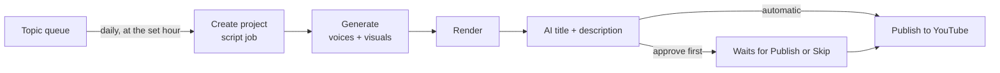

# ReelForge: daily autopilot

| | |
|---|---|
| Date | 2026-11-29 |
| Status | Design, agreed with the product owner on 2026-11-29 ("do whatever you think is good") |
| Goal | One Reel a day, made and published without the creator starting each one |

## Decisions

- **Channel niche:** sports legends, for a **global** English-speaking audience. Football and Formula 1 carry the week; cricket has one day (its audience is mostly South Asian).
- **Default rotation** (editable): football Monday, Wednesday, Friday and Sunday; F1 Tuesday and Saturday; cricket Thursday.
- **Default time:** 17:00 UTC (US midday, European evening). Editable.
- **Posting mode:** starts as **approve first** (the Reel is made, the creator presses Publish or Skip). A switch makes it fully automatic. Reason: facts about real people must be right, and YouTube doesn't monetise channels it judges mass-produced.
- **No real footage and no lookalikes.** Scenes use stock clips and AI images. The script model gets two rules of its own, outside the creator's quoted text: only widely documented facts (no invented quotes, private life or rumours), and visuals that never name or describe a real person. Every AI image prompt of an autopilot Reel starts with a no-face rule and has the legend's name replaced by "the athlete". A script rewritten later keeps the rules.
- **Nothing is charged differently:** each Reel costs what the same Reel costs by hand. If the credits run out, the run stops and says so.

## How it works

Two scheduled tasks drive it, using only what exists already (projects, jobs, renders, posts):

- **`autopilot.start`** (hourly): for each creator with autopilot on whose hour it is and who has no run today, takes the next queued topic and creates its project.
- **`autopilot.advance`** (every 2 minutes): moves each running topic one step, by looking at its project's status: `draft` → Generate; `ready` → Render; `rendered` → write the post text, then publish or wait. A failed step marks the topic `failed` with the reason; nothing is retried automatically.

Each step runs as the creator, through the same functions the screens call, so every rule (credits, locks, limits) applies unchanged.

## Data (migration 0003)

**autopilot_settings** (one row per user): `enabled`, `mode` (`approve` | `auto`), `run_hour_utc`, `rotation` (weekday → category), `tone`, `target_seconds`, `visibility`, `last_run_on`.

**autopilot_topics**: `user_id`, `position`, `category`, `subject`, `angle`, `status` (`queued`, `running`, `awaiting_approval`, `publishing`, `published`, `skipped`, `failed`), `project_id`, `error`, `run_on`.

## API (group L)

| # | Endpoint | Purpose |
|---|---|---|
| L1 | `GET /autopilot` | Settings, the queue and recent runs |
| L2 | `PATCH /autopilot` | Change settings. Turning it on needs a connected YouTube channel |
| L3 | `POST /autopilot/topics/suggest` | The language model proposes 14 topics in the rotation (a job, free). They are added to the queue |
| L4 | `POST /autopilot/topics` | Add one topic by hand |
| L5 | `DELETE /autopilot/topics/:id` | Remove a queued topic or a run from the list. For a run under way this is the **stop**: the autopilot takes it no further and the Reel stays as it is |
| L6 | `POST /autopilot/topics/:id/approve` | Publish a Reel that is waiting. `409 render_outdated` if the Reel was edited after its video was made: the autopilot renders it again and it waits once more, so an old video is never published. `409 not_waiting` otherwise |
| L7 | `POST /autopilot/topics/:id/skip` | Don't publish it (the Reel stays in the library) |
| L8 | `POST /autopilot/run` | Start the next topic now (one run at a time; it doesn't count as the day's scheduled run). `409 queue_empty`, `409 not_started` with the reason |

## Edge cases

| # | Case | Behaviour |
|---|---|---|
| AP-1 | The queue is empty | The day is skipped; the screen says the queue is empty |
| AP-2 | Not enough credits | The topic fails with that reason; autopilot stays on |
| AP-3 | YouTube needs reconnecting, or is switched off | The Reel waits as `awaiting_approval` with the reason |
| AP-4 | A step fails (script refused, a scene failed, render failed) | The topic is `failed` with the reason; the project stays for the creator to fix by hand |
| AP-5 | Yesterday's Reel still awaits approval | Today's still runs; several can wait |
| AP-6 | The server was down at the hour | The run starts at the next hourly check on the same day |
| AP-7 | The creator edits the autopilot's project by hand | The autopilot carries on from whatever status the project has (an edit means a new render, at the usual cost) |
| AP-8 | A run never finishes | After 4 hours it is failed with that reason, so it can't block the following days |
| AP-9 | The title and description can't be written (hourly limit, model down) | The Reel's own title is used; a finished Reel is never failed for its post text |
| AP-10 | Autopilot is turned off during a run | The run under way finishes its current path; use **Stop** on the run to end it |

## Screen: `/app/autopilot`

A switch (on/off), the mode, the hour and the rotation; the queue with **Suggest topics**, add and remove; and the runs: waiting ones with the video, **Publish** and **Skip**; published ones with their link; failed ones with the reason.

## Limits to know (from the QA review, 2026-11-29)

- **Days are UTC.** The rotation's weekday and "once a day" both use UTC; the screen shows the hour in local time.
- **Credits:** a 30-second Reel costs about 5 to 7 credits, so 100 a month covers 14 to 20 Reels. A daily channel needs a larger allowance (an admin can set it).
- **Voice quota:** the free ElevenLabs plan covers part of a month of daily Reels; after that the voice falls back to Edge TTS, which sounds different. The free plan's terms on commercial use should be checked before monetising.
- **YouTube:** each upload uses a large share of the API project's daily quota (about 6 uploads a day for the whole app). While the Google app is in Testing, the connection expires every 7 days and must be reconnected. YouTube may keep uploads private until the app is audited, and it does not monetise channels it judges mass-produced. The upload does not yet set YouTube's "altered or synthetic content" disclosure.
- **Stock footage and trade marks** (club crests, team liveries) are not covered by the rules above.
