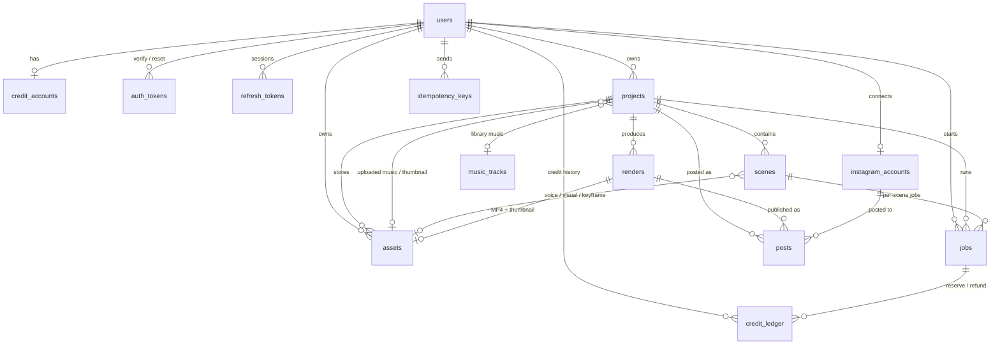

# ReelForge: database design

| | |
|---|---|
| Version | 1.0 |
| Date | 2026-11-11 |
| Database | PostgreSQL 16 (RDS in AWS, Docker locally) |
| Exact schema | [schema.sql](schema.sql), tested on PostgreSQL 16 |
| Related | [API design](API_DESIGN.md), [Technical design](TECHNICAL_DESIGN.md), [PRD](PRD.md) |

---

## 1. Overview

**16 tables** in 5 groups:

| Group | Tables |
|---|---|
| Users and sign-in | `users`, `auth_tokens`, `refresh_tokens`, `instagram_accounts` |
| Credits | `credit_accounts`, `credit_ledger` |
| Content | `projects`, `scenes`, `assets`, `music_tracks` |
| Work and output | `jobs`, `renders`, `posts` |
| Platform | `provider_switches`, `idempotency_keys`, `usage_daily` |

### Design principles

1. **The database is the source of truth; Redis is not.** Job state, credits and statuses live in PostgreSQL, so a Redis restart loses nothing important.
2. **Rules are enforced by the database as well as the code**: `CHECK` constraints for allowed values, partial unique indexes for "only one at a time" rules, and a non-negative credit balance. A bug in the code can't break these.
3. **UUID primary keys** everywhere (`gen_random_uuid()`), so ids can't be guessed or counted.
4. **Allowed values are `text` + `CHECK`**, not Postgres enums, because adding a value is a simple migration.
5. **Times are `timestamptz`** in UTC.
6. **JSONB only for data that is read and written as a whole**: the timeline, project settings, caption word timings, job input/output, asset metadata. Anything that is filtered or joined on has its own column.
7. **Soft delete** (`deleted_at`) for users and projects, then a scheduled purge, so accidental deletes can be undone for 7 days.
8. **`updated_at` is maintained by a trigger**, not by application code.

## 2. Entity relationship diagram



## 3. Tables

Every table has `id uuid` primary key and `created_at`, unless stated. Tables that are edited also have `updated_at`.

### 3.1 users

The creator's account and defaults.

| Column | Type | Rules | Notes |
|---|---|---|---|
| email | citext | unique, required | Case-insensitive: `A@x.com` = `a@x.com` |
| password_hash | text | required | argon2id. Email and password is the only sign-in in v1 |
| email_verified_at | timestamptz | | null until verified; generation is blocked until set |
| name, niche | text | | |
| default_voice_id | text | | |
| default_caption_style | text | `bold-pop`, `clean`, `neon` | |
| default_mode | text | `faceless`, `full_ai` | |
| onboarding_completed_at | timestamptz | | Onboarding shown while null |
| is_admin | boolean | default false | Access to `/admin` |
| is_tester | boolean | default false | Larger monthly credit allowance |
| disabled_at | timestamptz | | Admin can block an account |
| last_login_at | timestamptz | | |
| deleted_at | timestamptz | | Soft delete; purged after 7 days |

### 3.2 auth_tokens

One-time tokens for email verification and password reset.

| Column | Type | Rules | Notes |
|---|---|---|---|
| user_id | uuid → users | cascade | |
| kind | text | `verify_email`, `reset_password` | |
| token_hash | text | unique | Only a SHA-256 hash is stored; the email link holds the token |
| expires_at | timestamptz | required | 24 h for verification, 1 h for reset |
| used_at | timestamptz | | Set on use; a used token is rejected (A-2) |

### 3.3 refresh_tokens

One row per issued refresh token (sessions).

| Column | Type | Rules | Notes |
|---|---|---|---|
| user_id | uuid → users | cascade | |
| jti | text | unique | Token id inside the JWT |
| family_id | uuid | | All rotations from one login. If an already-used token is presented, the whole family is revoked (stolen-token protection) |
| user_agent, ip_address | text, inet | | Shown in a future "active sessions" list |
| expires_at, revoked_at | timestamptz | | |

### 3.4 instagram_accounts

At most one connected account per user in v1.

| Column | Type | Rules | Notes |
|---|---|---|---|
| user_id | uuid → users | unique, cascade | |
| ig_user_id | text | required | Instagram's id for the account |
| username, profile_picture_url | text | | |
| account_type | text | `BUSINESS`, `MEDIA_CREATOR` | Personal accounts are never stored (IG-1) |
| access_token_enc | bytea | required | Encrypted long-lived token |
| token_expires_at | timestamptz | required | About 60 days after issue or refresh |
| scopes | text[] | | Granted permissions |
| status | text | `connected`, `expired`, `revoked` | |
| last_refreshed_at | timestamptz | | |

### 3.5 credit_accounts

The current balance per user. One row per user, created at sign-up.

| Column | Type | Rules | Notes |
|---|---|---|---|
| user_id | uuid → users | primary key, cascade | |
| balance | integer | `>= 0` | Cached sum of the ledger, changed only together with a ledger row |
| monthly_allowance | integer | `>= 0` | 100 normally, 500 for testers |
| resets_at | timestamptz | required | Next monthly grant |

### 3.6 credit_ledger

Every credit movement, never edited or deleted (audit trail).

| Column | Type | Rules | Notes |
|---|---|---|---|
| user_id | uuid → users | cascade | |
| amount | integer | not 0 | `reserve` must be negative; `grant` and `refund` positive; `adjust` either |
| kind | text | `grant`, `reserve`, `refund`, `adjust` | |
| job_id | uuid → jobs | | Unique per `(job_id, kind)` for reserve and refund: a job is charged once and refunded at most once |
| note | text | | For example "Monthly allowance" or the admin's reason |
| created_by | uuid → users | | Admin who made an `adjust` |

### 3.7 music_tracks

The royalty-free music library, managed by the admin.

| Column | Type | Rules | Notes |
|---|---|---|---|
| title | text | required | |
| s3_key | text | unique | `library/music/...` |
| duration_seconds | numeric(8,3) | `> 0` | |
| moods | text[] | GIN index | Matched against the project's music mood |
| license, source_url | text | license required | Shown in the credits list (risk: music copyright) |
| is_active | boolean | | Inactive tracks are hidden but old projects keep working |

### 3.8 projects

One Reel.

| Column | Type | Rules | Notes |
|---|---|---|---|
| user_id | uuid → users | cascade | |
| title, topic | text | | |
| source_script | text | | Set when the creator pasted their own script |
| tone | text | `educational`, `funny`, `motivational`, `storytelling`, `dramatic` | |
| mode | text | `faceless`, `full_ai` | |
| target_seconds | integer | 15, 30, 60, 90 | |
| style, character | text | | Full AI style anchor |
| voice_id | text | | |
| music_mood | text | one of the 10 moods | |
| music_track_id | uuid → music_tracks | set null | Chosen library track |
| music_asset_id | uuid → assets | set null | Uploaded music, used instead of the library track |
| settings | jsonb | | `captionStyle`, `showCaptions`, `voiceVolume`, `musicVolume`, `duckedVolume`, `ducking`, `transition` |
| status | text | see section 5 | |
| timeline | jsonb | | Last built timeline (asset references, not URLs) |
| timeline_version | integer | | +1 on every rebuild |
| post_caption | text | ≤ 2,200 characters | Instagram's limit |
| hashtags | text[] | ≤ 30 items | Instagram's limit |
| thumbnail_asset_id | uuid → assets | set null | |
| deleted_at | timestamptz | | Soft delete |

### 3.9 scenes

The building block of a project. Ordered by `position`.

| Column | Type | Rules | Notes |
|---|---|---|---|
| project_id | uuid → projects | cascade | |
| position | integer | `>= 1`, unique per project (deferrable) | Deferrable so a reorder can swap positions in one transaction |
| narration | text | 1–1,500 characters | |
| on_screen_text | text | ≤ 80 characters | |
| visual_prompt, stock_query | text | | |
| mood | text | one of the 10 moods | |
| visual_source | text | `stock`, `ai_image`, `ai_video`, `upload` | |
| voice_asset_id, visual_asset_id, keyframe_asset_id | uuid → assets | set null | Current versions |
| words | jsonb | | `[{"text","start","end"}]`, seconds from scene start |
| words_edited | boolean | | Creator fixed caption words by hand; warn before regenerating voice (CA-4) |
| trim_start, trim_end | numeric(6,3) | `trim_end > trim_start` | Trim of the visual, in seconds |
| voice_status, visual_status | text | `missing`, `outdated`, `queued`, `running`, `ready`, `failed` | |
| last_error | text | | Plain-language message shown on the scene |

### 3.10 assets

Every stored file: generated, uploaded or rendered.

| Column | Type | Rules | Notes |
|---|---|---|---|
| user_id | uuid → users | cascade | |
| project_id | uuid → projects | cascade, nullable | |
| kind | text | `voice`, `image`, `video_clip`, `keyframe`, `music`, `upload`, `render`, `thumbnail` | |
| status | text | `pending_upload`, `ready`, `rejected` | Uploads start `pending_upload` until checked |
| s3_key | text | unique | |
| content_type | text | required | |
| size_bytes | bigint | `>= 0` | |
| duration_seconds | numeric(8,3) | | Audio and video |
| width, height | integer | | Images and video |
| provider | text | required | `elevenlabs`, `pexels`, `cloudflare`, `hf_space`, `upload`, `render`... |
| input_hash | text | | Hash of the inputs that produced it; same hash = reuse (replaces the prototype's `cache.json`) |
| meta | jsonb | | Prompt, seed, license, source URL, attribution |
| replaced_at | timestamptz | | Set when a newer version replaces it; deleted 7 days later |

### 3.11 jobs

One unit of background work.

| Column | Type | Rules | Notes |
|---|---|---|---|
| user_id | uuid → users | cascade | |
| project_id, scene_id | uuid | cascade, nullable | `ideas` jobs have no project |
| type | text | `ideas`, `script`, `rewrite_scene`, `hooks`, `caption`, `voice`, `transcribe`, `visual`, `keyframe`, `ai_video`, `music`, `render`, `publish` | |
| state | text | `queued`, `running`, `succeeded`, `failed`, `cancelled` | |
| progress | smallint | 0–100 | |
| provider | text | | Provider that finally served it |
| attempts | smallint | | |
| celery_task_id | text | | For cancelling |
| credits_reserved | integer | `>= 0` | |
| cost_estimate_usd | numeric(10,5) | | Our cost, for the admin usage page |
| input, output | jsonb | | Parameters; result references |
| error_code, error_message | text | | |
| queued_at, started_at, finished_at | timestamptz | | |

Two partial unique indexes stop duplicate work (G-12):
- one active job per `(scene_id, type)`;
- one active `script`, `music` or `render` job per project.

### 3.12 renders

One MP4 render of a project.

| Column | Type | Rules | Notes |
|---|---|---|---|
| project_id | uuid → projects | cascade | |
| job_id | uuid → jobs | set null | |
| timeline_version | integer | required | |
| timeline | jsonb | required | Exact snapshot that was rendered (R-3) |
| asset_id, thumbnail_asset_id | uuid → assets | set null | The MP4 and its cover frame |
| state | text | `queued`, `running`, `succeeded`, `failed`, `cancelled` | |
| progress | smallint | 0–100 | |
| error_message | text | | |
| finished_at | timestamptz | | |

A render is **outdated** when `renders.timeline_version < projects.timeline_version`. Computed, not stored.

### 3.13 posts

One attempt to publish a render to Instagram.

| Column | Type | Rules | Notes |
|---|---|---|---|
| project_id, render_id | uuid | cascade | |
| instagram_account_id | uuid → instagram_accounts | set null | |
| job_id | uuid → jobs | set null | |
| caption | text | ≤ 2,200 characters | Final caption including hashtags |
| share_to_feed | boolean | | |
| container_id | text | | Saved before polling (crash safety, IG-8) |
| media_id, permalink | text | | After publishing |
| state | text | `queued`, `uploading`, `processing`, `publishing`, `published`, `failed` | |
| error_message | text | | |
| published_at | timestamptz | | |

Unique `render_id` where state is not `failed`: one live post per render (IG-7). A failed post can be retried with a new row.

### 3.14 provider_switches

Admin kill switch per provider (AD2). Primary key `provider` (for example `hf_space`), `enabled`, `reason`, `updated_by`. Workers read it (cached in Redis for 30 seconds) before calling a provider.

### 3.15 idempotency_keys

Makes generate, render and publish safe to repeat. Primary key `(user_id, key)`; `request_hash` (the same key with a different body is rejected), `status_code` and `response_body` (returned again for a repeat). Rows older than 24 hours are deleted.

### 3.16 usage_daily

Daily totals for the admin usage page. Primary key `(day, provider, job_type)`; `calls`, `failures`, `credits_charged`, `cost_estimate_usd`. Filled nightly from `jobs`; lets old jobs be deleted after 90 days.

## 4. Indexes

| Index | Used by |
|---|---|
| `projects (user_id, updated_at desc) where deleted_at is null` | Dashboard list |
| `projects (user_id, status) where deleted_at is null` | Dashboard filter |
| `scenes unique (project_id, position)` | Loading scenes in order; reorder |
| `assets (project_id, kind, input_hash)` | Cache lookup before generating |
| `assets (replaced_at)`, `assets (created_at) where pending_upload` | Cleanup tasks |
| `jobs unique (scene_id, type) where active` | Duplicate protection |
| `jobs (project_id, state)` | Editor polling for active jobs |
| `jobs (state, started_at) where running` | Stuck-job task |
| `jobs (finished_at desc) where failed` | Admin failed-jobs page |
| `credit_ledger unique (job_id, kind)` | Charge once, refund once |
| `credit_ledger (user_id, created_at desc)` | Credit history |
| `renders (project_id, created_at desc)` | Latest render |
| `posts unique (render_id) where not failed` | One post per render |
| `instagram_accounts (token_expires_at) where connected` | Token refresh task |
| `credit_accounts (resets_at)` | Monthly reset task |
| `music_tracks using gin (moods)` | Music by mood |

## 5. Status models

**projects.status**

```
scripting ─► draft ─► generating ─► ready ─► rendering ─► rendered ─► posting ─► posted
                          │           ▲          │                       │
                          ▼           │          ▼                       ▼
                   needs_attention ───┘    render_failed            post_failed
   editing a ready / rendered / posted project ─► back to ready (or draft if something is now missing)
```

**scenes.voice_status / visual_status**

```
missing ─► queued ─► running ─► ready
                        │         │ (narration, mood, voice or prompt changed)
                        ▼         ▼
                      failed   outdated ─► queued ...
```

**jobs.state**: `queued → running → succeeded | failed`; `queued | running → cancelled`.

## 6. Key queries

### 6.1 Reserve credits and create a job (one transaction)

```sql
BEGIN;
SELECT balance FROM credit_accounts WHERE user_id = :user FOR UPDATE;   -- locks the row
-- application: if balance < :cost → ROLLBACK, return insufficient_credits
INSERT INTO jobs (id, user_id, project_id, scene_id, type, credits_reserved, input)
     VALUES (:job, :user, :project, :scene, 'voice', :cost, :input);
INSERT INTO credit_ledger (user_id, amount, kind, job_id, note)
     VALUES (:user, -:cost, 'reserve', :job, 'Voiceover');
UPDATE credit_accounts SET balance = balance - :cost WHERE user_id = :user;
UPDATE scenes SET voice_status = 'queued' WHERE id = :scene;
COMMIT;
```

### 6.2 Refund a failed job (safe to run twice)

```sql
BEGIN;
INSERT INTO credit_ledger (user_id, amount, kind, job_id, note)
     SELECT user_id, credits_reserved, 'refund', id, 'Refund: ' || type
       FROM jobs WHERE id = :job AND credits_reserved > 0
ON CONFLICT DO NOTHING
  RETURNING amount;
-- application: only if a row was returned:
UPDATE credit_accounts SET balance = balance + :amount WHERE user_id = :user;
COMMIT;
```

### 6.3 What does a project still need? (`advance_project`)

```sql
SELECT s.id, s.voice_status, s.visual_status,
       EXISTS (SELECT 1 FROM jobs j WHERE j.scene_id = s.id AND j.state IN ('queued','running')) AS busy
  FROM scenes s
 WHERE s.project_id = :project
 ORDER BY s.position;
```

### 6.4 Reuse an identical asset (cache)

```sql
SELECT id, s3_key, duration_seconds FROM assets
 WHERE project_id = :project AND kind = 'voice' AND input_hash = :hash AND status = 'ready'
 ORDER BY created_at DESC LIMIT 1;
```

### 6.5 Dashboard

```sql
SELECT p.id, p.title, p.mode, p.status, p.updated_at, a.s3_key AS thumbnail_key
  FROM projects p LEFT JOIN assets a ON a.id = p.thumbnail_asset_id
 WHERE p.user_id = :user AND p.deleted_at IS NULL
   AND (:status IS NULL OR p.status = :status)
 ORDER BY p.updated_at DESC
 LIMIT 20;
```

## 7. Security and privacy

- Every query in the API includes `user_id = :current_user` (or a join to a project that does). Ids alone never grant access.
- Instagram tokens are encrypted before they reach the database; the key is in Secrets Manager, not in the database.
- Passwords are hashed with argon2id; one-time tokens are stored only as hashes.
- The application connects as a role without `DROP` or `TRUNCATE` rights; migrations use a separate role.
- RDS: private subnet, encryption at rest, automated daily backups kept 7 days.

## 8. Data lifecycle

| Data | Kept for | Done by |
|---|---|---|
| Replaced assets | 7 days, then row and S3 file deleted | `cleanup_replaced_assets` |
| Uploads never completed (`pending_upload`) | 24 hours | `cleanup_replaced_assets` |
| Soft-deleted projects and accounts | 7 days, then purged with files | `purge_deleted` |
| Jobs | 90 days, then summarised into `usage_daily` | nightly task |
| Idempotency keys | 24 hours | nightly task |
| Expired or revoked refresh tokens | 30 days after expiry | nightly task |
| Credit ledger | Forever | |
| Renders | While the project exists; S3 moves files older than 90 days to cheaper storage | S3 lifecycle rule |

## 9. Migrations

- Alembic (through Flask-Migrate) owns the schema. The first migration creates exactly what is in [schema.sql](schema.sql).
- Every migration must be backwards compatible with the running code for one release: add columns as nullable or with defaults, backfill, then make required in a later release.
- Migrations run as a one-off task before a new version starts (see the technical design, CI/CD).
- Local development seeds: one admin, one tester, one normal user, 6 music tracks, and a sample project.
