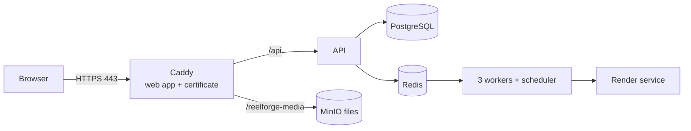

# Deploying ReelForge to one Azure VM

One Ubuntu virtual machine runs everything with Docker Compose, the same containers as on your laptop plus Caddy for HTTPS. It fits the $100 Azure for Students credit. Other options are compared in [DEPLOYMENT_OPTIONS.md](DEPLOYMENT_OPTIONS.md).



Only ports 80 and 443 (and 22 for you) are open. The database, Redis and storage are reachable only inside the VM.

## What it costs

| Size | vCPU / RAM | About | Good for |
|---|---|---|---|
| `Standard_B2ms` | 2 / 8 GB | $60 a month always-on | Recommended |
| `Standard_B2s` | 2 / 4 GB | $30 a month | Tight: rendering may run out of memory |

Prices are from memory; the portal shows the real one when you pick the size. **Stop (deallocate) the VM** in the portal when you aren't using it: a stopped VM costs only its disk, a few dollars a month. The daily autopilot needs it running at its hour.

## 1. Create the VM (Azure portal)

1. **Create a resource → Virtual machine.**
2. **Basics:**
   - Resource group: new, `reelforge`.
   - Name: `reelforge`.
   - Region: one the student subscription allows (try Central India or East US).
   - Image: **Ubuntu Server 24.04 LTS**.
   - Size: `Standard_B2ms`.
   - Authentication: **SSH public key**, username `azureuser`, generate a new key pair. Download the `.pem` file when asked and keep it safe.
   - Inbound ports: allow **SSH (22), HTTP (80), HTTPS (443)**.
3. **Disks:** 64 GB Standard SSD (the images and videos need room; the default 30 GB is too small).
4. **Review + create.**
5. Open the VM → **Overview → DNS name → Not configured**. Set a DNS name label, for example `reelforge-yourname`. Your address is then `reelforge-yourname.<region>.cloudapp.azure.com`. This is the **DOMAIN** below.
6. Tighten SSH: **Networking → the SSH rule → Source: My IP address**.

## 2. Install Docker on the VM

From PowerShell on your laptop (the key's path and the domain are yours):

```powershell
ssh -i C:\Users\you\Downloads\reelforge_key.pem azureuser@reelforge-yourname.centralindia.cloudapp.azure.com
```

Then on the VM:

```bash
curl -fsSL https://get.docker.com | sudo sh
sudo usermod -aG docker $USER && newgrp docker
docker --version && docker compose version
```

## 3. Get the code

```bash
git clone https://github.com/praveenmarch22/reelforge-backend.git backend
git clone https://github.com/praveenmarch22/reelforge-frontend.git frontend
cd backend
```

The two folders must sit side by side: the web app's image is built from `../frontend`.

## 4. Settings and secrets

```bash
python3 deploy/make_env.py reelforge-yourname.centralindia.cloudapp.azure.com
nano .env.production
```

`make_env.py` fills the domain and makes fresh random secrets. In the editor, fill in:

- the provider keys and the YouTube client id and secret (the same values as in your laptop's `backend/.env`);
- the mail settings. A free Brevo account works: **SMTP & API → SMTP** gives the host (`smtp-relay.brevo.com`), port 587, login and key. `EMAIL_FROM` must be a sender you verified there.

Never commit `.env.production`; it is ignored by git.

## 5. Start it

```bash
docker compose --env-file .env.production -f docker-compose.prod.yml up -d --build
docker compose --env-file .env.production -f docker-compose.prod.yml ps
```

The first build takes 10 to 15 minutes (the render service downloads Chrome). When every service is `healthy` or `running`, open `https://<DOMAIN>`. Caddy gets the HTTPS certificate by itself within a minute.

Add the music library once:

```bash
docker compose --env-file .env.production -f docker-compose.prod.yml exec api flask music-seed
```

## 6. Google Cloud: allow the new address

In Google Cloud → **Google Auth Platform → Clients → ReelForge local → Authorised redirect URIs**, add:

```
https://<DOMAIN>/api/v1/connections/youtube/callback
```

Keep the localhost one, so connecting still works on your laptop.

## 7. First account

1. Sign up on the live site and verify your email.
2. Make yourself an admin (replace the email):

```bash
docker compose --env-file .env.production -f docker-compose.prod.yml exec postgres \
  psql -U reelforge -d reelforge -c "UPDATE users SET is_admin = true WHERE email = 'you@example.com'"
```

3. In **Admin → Users**, raise your monthly credits if you'll use the daily autopilot (about 200).
4. **Settings → YouTube → Connect**, then turn the **Autopilot** on.

## Everyday commands

Run them in `~/backend`. To save typing: `alias dc='docker compose --env-file .env.production -f docker-compose.prod.yml'`.

| To | Command |
|---|---|
| See what's running | `dc ps` |
| Follow the API's log | `dc logs -f api` |
| Follow the workers | `dc logs -f worker render-worker publish-worker` |
| Update to the latest code | `git pull && (cd ../frontend && git pull) && dc up -d --build` |
| Restart one service | `dc restart api` |
| Back up the database | `dc exec postgres pg_dump -U reelforge reelforge > backup-$(date +%F).sql` |
| Stop everything (data kept) | `dc down` |

## If something is wrong

| What you see | Likely cause |
|---|---|
| The browser can't connect | The VM is stopped, or ports 80/443 aren't open in **Networking** |
| A certificate warning | The DNS name label isn't set, or `DOMAIN` in `.env.production` doesn't match it. `dc logs web` says why |
| `api` keeps restarting | A setting is missing or unsafe; `dc logs api` names it |
| Sign-up works but no email arrives | The mail settings or the sender address; `dc logs worker` shows the SMTP answer |
| "Connect YouTube" fails with `redirect_uri_mismatch` | Step 6 wasn't done, or the address differs by a character |
| A render fails or the VM freezes | Out of memory: use `B2ms`, keep `RENDER_SCALE=2/3` |

## Known limits of this setup

- **One machine:** if it stops, the app stops. The data is on the VM's disk; take database backups.
- **Rendering is slow** on 2 cores (about 15 to 20 minutes for 30 seconds).
- **YouTube in Testing mode:** only test users can connect, and the connection expires every 7 days.
