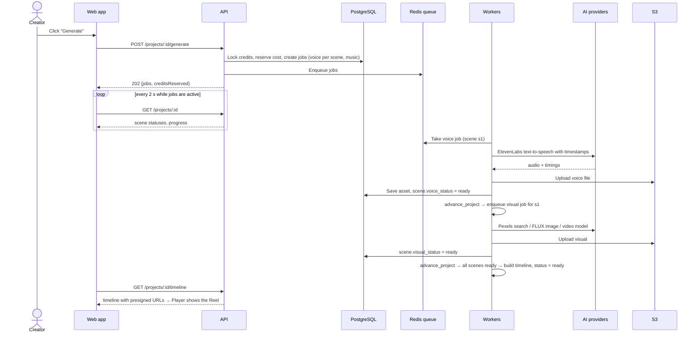
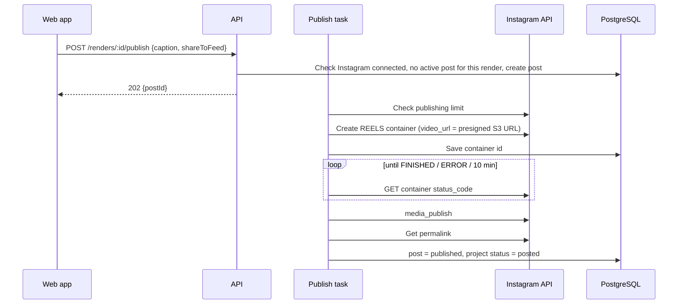
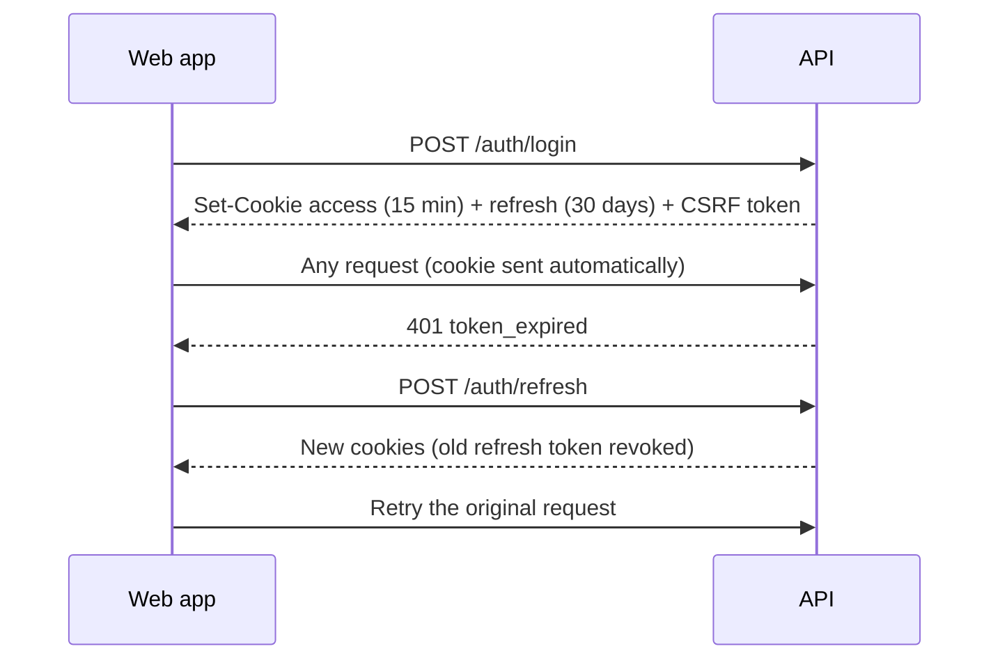
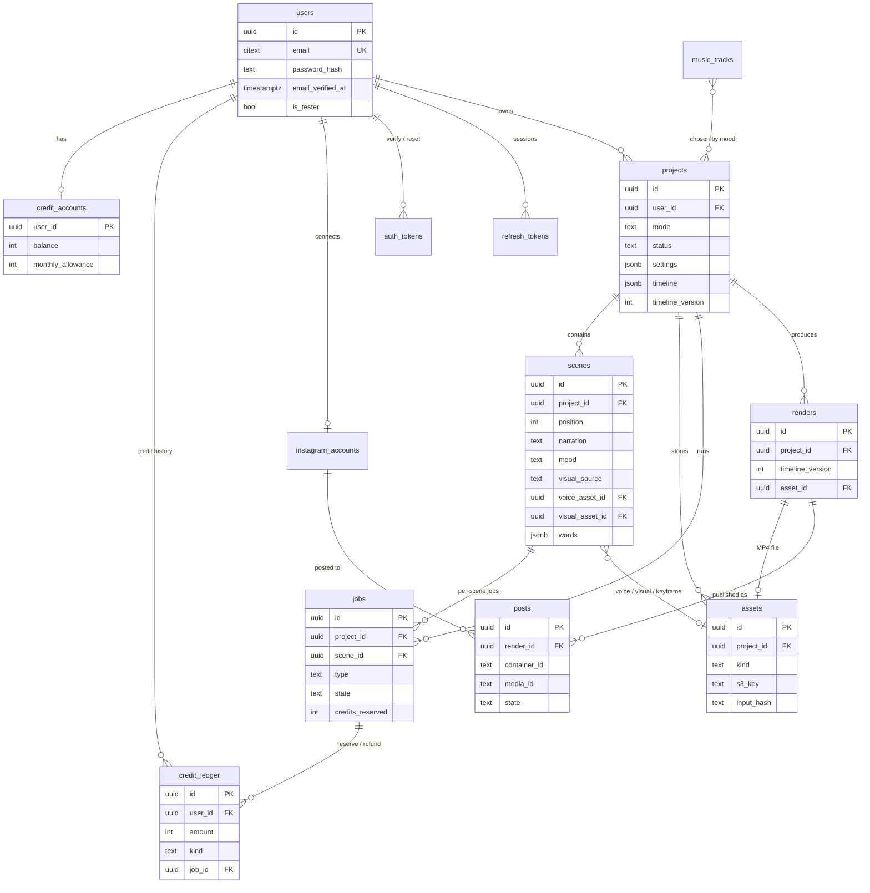

# ReelForge: technical design

| | |
|---|---|
| Version | 1.0 (draft) |
| Date | 2026-11-11 |
| Inputs | [PRD](PRD.md), [Pipeline strategy](PIPELINE_STRATEGY.md), the prototype in this repository |
| Status | Draft for review |

The PRD says **what** ReelForge does. This document says **how** it is built: services, tech stack, database, API, background jobs, integrations, security, deployment on AWS, and the build order.

---

## 1. Architecture overview

```
                         ┌─────────────────────────────┐
  Browser (React SPA) ──►│  CloudFront                 │──► S3: web app files
        │                └─────────────────────────────┘
        │ HTTPS /api
        ▼
  ┌──────────────┐   enqueue    ┌──────────┐   consume   ┌──────────────────────┐
  │  Flask API   │─────────────►│  Redis   │◄────────────│  Celery workers      │
  │  (Gunicorn)  │◄── progress ─│ (broker, │             │  - llm               │
  └──────┬───────┘              │  locks,  │             │  - voice             │
         │                      │  limits) │             │  - visuals           │
         │                      └──────────┘             │  - ai_video          │
         ▼                                               │  - publish           │
  ┌──────────────┐◄──────────────────────────────────────│  - maintenance (beat)│
  │ PostgreSQL   │                                       └───┬──────────┬───────┘
  └──────────────┘                                           │          │ HTTP
                                                             │          ▼
  ┌──────────────┐◄── presigned uploads / downloads ──┐      │   ┌──────────────────┐
  │  S3 (media)  │◄───────────────────────────────────┼──────┴──►│ Render service   │
  └──────────────┘                                    │          │ (Node, Remotion) │
         ▲                                            │          └──────────────────┘
         │ video_url                                  │
  Instagram Graph API ◄── publish task ───────────────┘
  AI providers (Gemini, Groq, ElevenLabs, Pexels, Cloudflare, Hugging Face) ◄── workers
```

**Rules that shape the design**

1. The API never calls an AI provider or renders anything. It validates, writes to the database and enqueues jobs, so every request returns in well under a second.
2. Workers do all slow and external work, and are the only code that holds provider API keys.
3. Files never pass through the API. Browsers upload and download directly to and from S3 with presigned URLs.
4. The timeline JSON is the single contract between the pipeline, the browser preview and the renderer (same as the prototype).

### 1.1 Components and responsibilities

| Component | Owns | Talks to | Never does |
|---|---|---|---|
| Web app (React) | Screens, editor state, live preview | API (JSON), S3 (presigned upload/download) | Hold API keys or call AI providers |
| API (Flask) | Auth, validation, projects, scenes, credits, timeline building, presigned URLs, Instagram OAuth | PostgreSQL, Redis (enqueue, rate limits), S3 (sign URLs) | Long-running work, provider calls |
| Workers (Celery) | Every AI call, downloads, music, render orchestration, Instagram publishing, scheduled tasks | Providers, PostgreSQL, S3, render service, Instagram | Serve HTTP requests |
| Render service (Node + Remotion) | Turning a timeline into an MP4 | S3 (read assets, write MP4), worker callback | Touch the database |
| PostgreSQL | All lasting state | | |
| Redis | Job queue, rate-limit counters, locks | | Store anything that must survive a restart |
| S3 / MinIO | All media files | | |

### 1.2 Request flows

**Generate a Reel (after the script is approved)**



**Render**

```mermaid
sequenceDiagram
    participant W as Web app
    participant A as API
    participant WK as Render task
    participant R as Render service
    participant S3 as S3
    participant DB as PostgreSQL

    W->>A: POST /projects/:id/render
    A->>DB: Check all scenes ready and length ≤ 90 s, reserve credits, create render + job
    A-->>W: 202 {renderId}
    WK->>R: POST /renders {timeline with presigned URLs, outputKey, callbackUrl}
    R->>S3: Download assets, render, upload MP4
    R-->>WK: Callback (signed) with result; the task also polls as backup
    WK->>DB: Render ready (asset id), project status = rendered
    W->>A: GET /renders/:id → download URL
```

**Publish to Instagram**



**Sign-in session**



### 1.3 Deployment view (Phase A on AWS)

```
                Route 53 (reelforge domain)
                       │
          ┌────────────┴─────────────┐
          ▼                          ▼
   CloudFront ── S3 (web app)   ALB / Caddy (TLS, api.reelforge...)
                                     │
                     ┌───────────────┴────────────────────────────┐
                     │ EC2 instance (Docker Compose)               │
                     │  api (Gunicorn)  worker(s)  beat            │
                     │  renderer (Node)  redis                     │
                     └───────┬───────────────────────┬─────────────┘
                             ▼                       ▼
                     RDS PostgreSQL           S3 media bucket (private)
                     (private subnet)
   Secrets Manager · SES · CloudWatch logs and alarms · Sentry
```

## 2. Tech stack

| Layer | Choice | Why |
|---|---|---|
| Frontend | React 18, TypeScript, Vite | Fast dev server; the user's chosen framework |
| Routing | React Router | Standard |
| Server data | TanStack Query | Caching, refetching and polling job progress |
| Editor state | Zustand | Small store for the timeline editor's local state and undo/redo |
| UI | Tailwind CSS + shadcn/ui | Quick, consistent components without a heavy library |
| Forms | React Hook Form + Zod | Validation shared in shape with the API |
| Video preview | `@remotion/player` | Plays the same components the renderer uses |
| API | Python 3.12, Flask 3, Gunicorn | The user's chosen backend |
| ORM and migrations | SQLAlchemy 2.0, Alembic (Flask-Migrate) | Standard for Flask |
| Request validation | Pydantic 2 | Already used by the prototype's models |
| Auth | JWTs (PyJWT) in httpOnly cookies, argon2 password hashing | No tokens in JavaScript; refresh tokens rotate. Built directly on PyJWT instead of Flask-JWT-Extended, because the cookie layout in the API design (one `rf_csrf` cookie, refresh cookie limited to `/api/v1/auth`) is simpler to write than to configure |
| Background jobs | Celery 5 + Redis | Retries, queues, scheduled tasks (beat) |
| Database | PostgreSQL 16 | JSONB for the timeline, row locks for credits |
| Rendering | Remotion 4 in a Node 20 service | Reuses the prototype renderer |
| Storage | Amazon S3 in AWS; MinIO (S3-compatible) locally | Media; presigned URLs; the same code works with both |
| AI services | See section 9.0 | Gemini, ElevenLabs, Groq Whisper, Pexels, Cloudflare FLUX, Hugging Face |
| Email | Amazon SES in AWS; locally a test inbox (Mailpit) over SMTP | Verification, password reset, notifications. Nothing leaves the machine in development |
| Errors | Sentry (free tier) | API, workers and frontend |
| Tests | pytest, Vitest, Playwright (later) | Unit, component and end-to-end |
| Local dev | Docker Compose | Postgres, Redis, API, worker, render service in one command |
| CI | GitHub Actions | Lint, type-check, test, build images |

## 3. Repository structure

Two git repositories (agreed on 2026-11-17), kept side by side on disk in a `reelforge/` folder:

```
reelforge/
├── frontend/                   repository: reelforge-frontend
│   └── src/                    React app (Vite, TypeScript, Tailwind)
│       ├── api/                typed API client + TanStack Query hooks
│       ├── mocks/              mock API (MSW) used until the backend exists
│       ├── components/         shared UI, layout, Reel cards
│       ├── features/           auth, dashboard, projects, then script, editor, publish, settings
│       └── lib/
└── backend/                    repository: reelforge-backend (this one)
    ├── pipeline/               Python generation pipeline (prototype; becomes the workers' core)
    ├── renderer/               Remotion render service (prototype)
    ├── api/                    Flask app (planned; structure to be agreed with the backend approach)
    │   └── reelforge_api/      app factory, models, routes, schemas, services, tasks, migrations
    ├── docker-compose.yml      planned: Postgres, Redis, MinIO, API, worker, renderer
    ├── docs/                   PRD, strategy, design documents, schema
    ├── MILESTONES.md
    ├── PROJECT_STATUS.md
    └── README.md
```

Because the frontend's live preview and the render service must use the same Remotion components, and they now live in separate repositories, the components will be published from `renderer/` as a small package (or copied on release) for the frontend to import. This is decided in milestone F6.

The backend's internal layout is provisional until the backend approach is agreed.

**What the prototype becomes**

| Prototype | Product |
|---|---|
| `pipeline/reelforge/providers`, `prompts.py`, `errors.py`, `timeline.py`, `models.py` | Imported by the Celery tasks (unchanged logic) |
| `pipeline/reelforge/pipeline.py` (orchestration) | Replaced by Celery tasks + the project state machine (section 7) |
| `cache.json` | `assets.input_hash` column in PostgreSQL |
| `renderer/src/*` | Shared video components, used by the render service and by the frontend's Player preview |
| `renderer/scripts/render.mjs` | Render service with an HTTP wrapper |
| Local file paths | S3 keys and presigned URLs |

## 4. Data model

> The full database design is in [DB_DESIGN.md](DB_DESIGN.md), with the exact tested schema in [schema.sql](schema.sql). Those files are authoritative; this section is a summary.

All tables have `id` (UUID, primary key), `created_at` and `updated_at` unless stated. Money-like values (credits) are integers.

### users
| Column | Type | Notes |
|---|---|---|
| email | citext, unique | |
| password_hash | text | email and password is the only sign-in method in v1 |
| email_verified_at | timestamptz, nullable | |
| name | text | |
| niche | text | |
| default_voice_id | text | |
| default_caption_style | text | `bold-pop`, `clean`, `neon` |
| default_mode | text | `faceless`, `full_ai` |
| is_admin | bool | |
| is_tester | bool | gets the larger test allowance |
| deleted_at | timestamptz, nullable | soft delete before purge |

### auth_tokens
One-time tokens for email verification and password reset.
| Column | Type | Notes |
|---|---|---|
| user_id | FK users | |
| kind | text | `verify_email`, `reset_password` |
| token_hash | text | store only a hash |
| expires_at, used_at | timestamptz | |

### refresh_tokens
| Column | Type | Notes |
|---|---|---|
| user_id | FK | |
| jti | text, unique | |
| expires_at, revoked_at | timestamptz | rotation: each use revokes the old one |

### instagram_accounts
| Column | Type | Notes |
|---|---|---|
| user_id | FK, unique | one account per user in v1 |
| ig_user_id | text | |
| username, profile_picture_url | text | |
| account_type | text | `BUSINESS`, `MEDIA_CREATOR` |
| access_token_enc | bytea | encrypted (section 10) |
| token_expires_at | timestamptz | long-lived, about 60 days |
| status | text | `connected`, `expired`, `revoked` |

### projects
| Column | Type | Notes |
|---|---|---|
| user_id | FK | |
| title, topic | text | |
| tone | text | |
| mode | text | `faceless`, `full_ai` |
| target_seconds | int | 15, 30, 60, 90 |
| style, character | text | Full AI style anchor |
| voice_id | text | |
| music_mood | text | |
| settings | jsonb | caption style, show captions, voice/music volumes, transitions |
| status | text | see section 7 |
| timeline | jsonb, nullable | last built timeline |
| timeline_version | int | increments on every rebuild |
| post_caption | text | |
| hashtags | text[] | |
| thumbnail_asset_id | FK assets, nullable | |
| deleted_at | timestamptz, nullable | |

### scenes
| Column | Type | Notes |
|---|---|---|
| project_id | FK | |
| position | int | order; unique per project |
| narration | text | |
| on_screen_text | text | |
| visual_prompt, stock_query | text | |
| mood | text | |
| visual_source | text | `stock`, `ai_image`, `ai_video`, `upload` |
| voice_asset_id | FK assets, nullable | current voiceover |
| visual_asset_id | FK assets, nullable | current visual |
| keyframe_asset_id | FK assets, nullable | Full AI keyframe |
| words | jsonb | word timings for captions (editable, feature C3) |
| trim_start, trim_end | numeric, nullable | seconds trimmed from the visual |
| voice_status, visual_status | text | `missing`, `outdated`, `queued`, `running`, `ready`, `failed` |
| last_error | text | plain-language message |

### assets
Every stored file, generated or uploaded.
| Column | Type | Notes |
|---|---|---|
| user_id, project_id | FK | |
| kind | text | `voice`, `image`, `video_clip`, `keyframe`, `music`, `upload`, `render`, `thumbnail` |
| s3_key | text | |
| content_type | text | |
| size_bytes | bigint | |
| duration_seconds | numeric, nullable | |
| width, height | int, nullable | |
| provider | text | `elevenlabs`, `pexels`, `upload`... |
| input_hash | text, indexed | replaces the prototype's cache: same hash = reuse |
| meta | jsonb | license, source URL, prompt, seed |
| replaced_at | timestamptz, nullable | set when a newer asset replaces it; cleanup after 7 days |

### jobs
| Column | Type | Notes |
|---|---|---|
| user_id, project_id | FK | |
| scene_id | FK, nullable | |
| type | text | `ideas`, `script`, `rewrite_scene`, `voice`, `visual`, `keyframe`, `ai_video`, `music`, `render`, `publish` |
| state | text | `queued`, `running`, `succeeded`, `failed`, `cancelled` |
| progress | int | 0–100 |
| provider | text | which provider finally served it |
| attempts | int | |
| celery_task_id | text | |
| credits_reserved | int | |
| input | jsonb | parameters |
| output | jsonb | result references (asset ids) |
| error_code, error_message | text | |
| started_at, finished_at | timestamptz | |

Partial unique index: one active job per `(scene_id, type)` where `state in ('queued','running')`. This implements "clicking Generate twice does nothing" (edge case G-12).

### renders
| Column | Type | Notes |
|---|---|---|
| project_id | FK | |
| job_id | FK jobs | |
| timeline_version | int | the version that was rendered |
| asset_id | FK assets, nullable | the MP4 |
| state | text | |

A render is **outdated** when `renders.timeline_version < projects.timeline_version` (edge case R-3).

### posts
| Column | Type | Notes |
|---|---|---|
| project_id, render_id, instagram_account_id | FK | |
| caption | text | |
| share_to_feed | bool | |
| container_id | text | Instagram media container |
| media_id, permalink | text | after publishing |
| state | text | `queued`, `uploading`, `processing`, `publishing`, `published`, `failed` |
| error_message | text | |

Unique index on `render_id` where state is not `failed`: one post per render (IG-7).

### credit_accounts and credit_ledger
| Table | Columns |
|---|---|
| credit_accounts | `user_id` (unique), `balance` int, `monthly_allowance` int, `resets_at` timestamptz |
| credit_ledger | `user_id`, `amount` (+/−), `kind` (`grant`, `reserve`, `refund`, `adjust`), `job_id` nullable, `note` |

`balance` is a cached sum of the ledger, updated in the same transaction (section 8).

### music_tracks
| Column | Type |
|---|---|
| title, s3_key, duration_seconds | |
| moods | text[] |
| license, source_url | text |
| is_active | bool |

### provider_switches
| Column | Type |
|---|---|
| provider | text, unique |
| enabled | bool |
| reason | text |

The admin kill switch (AD2). Workers check it before calling a provider.

### 4.1 Entity relationship diagram



### 4.2 Allowed values

Stored as `text` with a `CHECK` constraint (easier to change than Postgres enums).

| Column | Values |
|---|---|
| projects.mode | `faceless`, `full_ai` |
| projects.status | `draft`, `scripting`, `generating`, `needs_attention`, `ready`, `rendering`, `render_failed`, `rendered`, `posting`, `post_failed`, `posted` |
| projects.tone | `educational`, `funny`, `motivational`, `storytelling`, `dramatic` |
| scenes.mood, projects.music_mood | `calm`, `joyful`, `excited`, `funny`, `inspiring`, `triumphant`, `serious`, `tense`, `mysterious`, `sad` |
| scenes.visual_source | `stock`, `ai_image`, `ai_video`, `upload` |
| scenes.voice_status, visual_status | `missing`, `outdated`, `queued`, `running`, `ready`, `failed` |
| assets.kind | `voice`, `image`, `video_clip`, `keyframe`, `music`, `upload`, `render`, `thumbnail` |
| jobs.type | `ideas`, `script`, `rewrite_scene`, `caption`, `voice`, `transcribe`, `visual`, `keyframe`, `ai_video`, `music`, `render`, `publish` |
| jobs.state | `queued`, `running`, `succeeded`, `failed`, `cancelled` |
| posts.state | `queued`, `uploading`, `processing`, `publishing`, `published`, `failed` |
| credit_ledger.kind | `grant`, `reserve`, `refund`, `adjust` |

### 4.3 Constraints and indexes

| Table | Constraint or index | Purpose |
|---|---|---|
| users | unique `lower(email)` (citext) | One account per email |
| credit_accounts | `CHECK (balance >= 0)` | Balance can never go negative, even with a bug |
| scenes | unique `(project_id, position)`, deferrable | Reordering inside one transaction |
| scenes | index `(project_id)` | Load a project's scenes |
| assets | index `(project_id, kind, input_hash)` | Cache lookup: reuse an identical asset |
| assets | index `(replaced_at)` where not null | Cleanup job |
| jobs | unique `(scene_id, type)` where `state in ('queued','running')` | No duplicate active jobs (G-12) |
| jobs | index `(project_id, state)` | Editor polling for active jobs |
| jobs | index `(state, started_at)` | Finding stuck jobs |
| renders | index `(project_id, created_at desc)` | Latest render |
| posts | unique `(render_id)` where `state <> 'failed'` | One post per render (IG-7) |
| credit_ledger | unique `(job_id, kind)` where `job_id is not null` | A job is reserved once and refunded once |
| credit_ledger | index `(user_id, created_at desc)` | Credit history page |
| projects | index `(user_id, updated_at desc)` where `deleted_at is null` | Dashboard list |
| auth_tokens | index `(token_hash)` | Token lookup |

Foreign keys use `ON DELETE CASCADE` from `projects` to `scenes`, `jobs`, `renders` and `posts`, so deleting a project removes its rows. `assets` are deleted by the cleanup task, which also deletes the S3 files, so no file is left without a row or a row without a file.

### 4.4 Example: a scene row and its timeline entry

The database stores what the creator edits; the timeline is built from it.

| scenes column | value |
|---|---|
| position | 1 |
| narration | "Most people never notice it, but it changes everything." |
| mood | `calm` |
| visual_source | `stock` |
| voice_asset_id → assets | `voice`, 3.6 s, `users/…/projects/…/voice/<job>.mp3` |
| visual_asset_id → assets | `video_clip`, 7.0 s, `users/…/visual/s2-a41b….mp4` |
| words | `[{"text": "Most", "start": 0.05, "end": 0.31}, …]` |

The timeline builder turns this into the scene entry shown in [PIPELINE_STRATEGY.md](PIPELINE_STRATEGY.md), with `startFrame` and `durationInFrames` computed from the voice length, and presigned URLs for `src`.

### 4.5 Data lifecycle

| Data | Kept for |
|---|---|
| Replaced assets (old voice or visual versions) | 7 days, then deleted |
| Renders | Forever while the project exists; older than 90 days moved to cheaper S3 storage |
| Deleted projects | Soft-deleted, purged with files after 7 days |
| Deleted accounts | Purged with all files and tokens within 7 days |
| Jobs | 90 days, then summarised into daily usage numbers |
| Credit ledger | Forever (audit trail) |

## 5. API

> The full API design, all 70 endpoints with request and response details, is in [API_DESIGN.md](API_DESIGN.md). That file is authoritative; this section is a summary.

REST over JSON, prefix `/api/v1`. Auth is by httpOnly cookies; state-changing requests send a CSRF header. Errors always have the same shape:

```json
{"error": {"code": "insufficient_credits", "message": "This needs 12 credits; you have 5.", "details": {"needed": 12, "balance": 5}}}
```

### 5.1 Conventions

| Topic | Rule |
|---|---|
| Base URL | `https://api.<domain>/api/v1` (locally `http://localhost:5000/api/v1`) |
| Format | JSON in and out; field names in `camelCase` in JSON, `snake_case` in Python and the database |
| IDs | UUIDs |
| Times | ISO 8601 in UTC, for example `2026-11-11T09:30:00Z` |
| Auth | Cookies `rf_access` and `rf_refresh` (httpOnly). Every POST, PATCH and DELETE sends header `X-CSRF-Token` |
| Slow actions | Return `202 Accepted` with job ids; the client polls the job or the project |
| Pagination | `?limit=20&cursor=<opaque>`; responses include `nextCursor` (null at the end) |
| Idempotency | Generation, render and publish requests accept an `Idempotency-Key` header; repeating a request with the same key returns the first result instead of starting new work |
| Versioning | Breaking changes go to `/api/v2`; additive changes stay in v1 |
| Validation | Pydantic models per request; unknown fields rejected |
| Rate limits | `429` with a `Retry-After` header |

### 5.2 Status codes and error codes

| HTTP | `error.code` | When |
|---|---|---|
| 400 | `validation_error` | Invalid body; `details.fields` lists each problem |
| 401 | `not_authenticated`, `token_expired` | No or expired session |
| 403 | `email_not_verified`, `forbidden` | Action not allowed |
| 404 | `not_found` | Missing, or belongs to another user (never reveals which) |
| 409 | `not_ready` | Render with scenes not ready; `details.scenes` lists them |
| 409 | `too_long` | Timeline over 90 seconds |
| 409 | `already_running` | Same job already active |
| 409 | `instagram_not_connected`, `instagram_reconnect_required` | Publishing without a valid connection |
| 402 | `insufficient_credits` | Not enough credits; `details.needed`, `details.balance` |
| 413 | `file_too_large` | Upload over the limit |
| 415 | `unsupported_file_type` | Upload of an unsupported format |
| 422 | `content_refused` | A provider's safety filter refused the prompt |
| 429 | `rate_limited` | Too many requests |
| 503 | `provider_unavailable` | Provider switched off by admin or all fallbacks down |

### 5.3 Main resources (response shapes)

**Project** (`GET /projects/:id`)

```json
{
  "id": "6f1c…",
  "title": "3 morning habits that changed my life",
  "topic": "morning habits",
  "tone": "motivational",
  "mode": "faceless",
  "targetSeconds": 30,
  "style": "cinematic",
  "character": "",
  "voiceId": "21m00Tcm4TlvDq8ikWAM",
  "musicMood": "inspiring",
  "status": "generating",
  "settings": {"captionStyle": "bold-pop", "showCaptions": true, "voiceVolume": 1.0,
               "musicVolume": 0.25, "duckedVolume": 0.08},
  "estimatedSeconds": 31.2,
  "timelineVersion": 4,
  "scenes": [
    {
      "id": "a91e…", "position": 1,
      "narration": "Most people never notice it, but it changes everything.",
      "onScreenText": "Most people miss this",
      "visualPrompt": "person waking up at sunrise, soft light",
      "stockQuery": "sunrise bedroom",
      "mood": "calm",
      "visualSource": "stock",
      "voiceStatus": "ready",
      "visualStatus": "running",
      "voice": {"assetId": "…", "durationSeconds": 3.6},
      "visual": null,
      "lastError": null
    }
  ],
  "activeJobs": [{"id": "…", "type": "visual", "sceneId": "a91e…", "state": "running", "progress": 40}],
  "latestRender": null,
  "latestPost": null,
  "createdAt": "2026-11-11T09:30:00Z",
  "updatedAt": "2026-11-11T09:31:12Z"
}
```

**Job** (`GET /jobs/:id`)

```json
{"id": "…", "type": "voice", "state": "failed", "progress": 0, "provider": "elevenlabs",
 "attempts": 3, "creditsReserved": 2, "creditsRefunded": true,
 "error": {"code": "provider_unavailable", "message": "The voice service is busy. Try again in a minute."},
 "output": null}
```

### 5.4 Example requests

**Create a project**

```http
POST /api/v1/projects
Content-Type: application/json
X-CSRF-Token: …

{"topic": "3 morning habits that changed my life", "tone": "motivational",
 "mode": "faceless", "targetSeconds": 30, "voiceId": "21m00Tcm4TlvDq8ikWAM"}
```

```http
202 Accepted
{"project": {"id": "6f1c…", "status": "scripting", …}, "job": {"id": "…", "type": "script", "state": "queued"}}
```

To start from a pasted script instead, send `"script": "full text…"` in place of `topic`; the API splits it into scenes itself (at sentence ends, so no word changes) and the LLM only adds titles, visual descriptions and moods.

**Edit a scene**

```http
PATCH /api/v1/scenes/a91e…
{"narration": "Almost nobody notices it, but it changes everything.", "mood": "tense"}
```

```http
200 OK
{"scene": {"id": "a91e…", "voiceStatus": "outdated", "visualStatus": "ready", …},
 "estimate": {"credits": 2, "items": [{"sceneId": "a91e…", "type": "voice", "credits": 2}]}}
```

Changing narration or mood marks the voice `outdated`; the response says what regenerating will cost.

**Estimate, then generate**

```http
GET /api/v1/projects/6f1c…/estimate
200 OK
{"credits": 4, "balance": 86,
 "items": [{"type": "voice", "count": 6, "credits": 4}, {"type": "visual", "count": 6, "credits": 0},
           {"type": "music", "count": 1, "credits": 0}, {"type": "ai_image_fallback", "maxCredits": 2}]}
```

```http
POST /api/v1/projects/6f1c…/generate
Idempotency-Key: 0c4f…
202 Accepted
{"jobs": [{"id": "…", "type": "voice", "sceneId": "…"}, …], "creditsReserved": 4, "balance": 82}
```

**Upload a file (presigned)**

```http
POST /api/v1/uploads
{"projectId": "6f1c…", "kind": "upload", "filename": "my-voice.m4a", "contentType": "audio/mp4", "sizeBytes": 1834221}
```

```http
201 Created
{"assetId": "…", "uploadUrl": "https://s3…?X-Amz-Signature=…", "method": "PUT",
 "headers": {"Content-Type": "audio/mp4"}, "expiresAt": "2026-11-11T09:45:00Z"}
```

The browser PUTs the file to `uploadUrl`, then calls `POST /uploads/:assetId/complete`; the API checks the real type and length before the file can be used.

**Render**

```http
POST /api/v1/projects/6f1c…/render
202 Accepted
{"render": {"id": "…", "state": "queued", "timelineVersion": 4}, "creditsReserved": 2}
```

```http
GET /api/v1/renders/…
200 OK
{"id": "…", "state": "succeeded", "progress": 100, "timelineVersion": 4, "outdated": false,
 "video": {"url": "https://s3…presigned", "durationSeconds": 31.4, "sizeBytes": 9420311},
 "thumbnailUrl": "https://s3…"}
```

**Publish**

```http
POST /api/v1/renders/…/publish
Idempotency-Key: 77ab…
{"caption": "3 habits that changed my mornings ☀️ Save this!", "hashtags": ["morningroutine", "habits"], "shareToFeed": true}
```

```http
202 Accepted
{"post": {"id": "…", "state": "queued"}}
```

```http
GET /api/v1/posts/…
200 OK
{"id": "…", "state": "published", "permalink": "https://www.instagram.com/reel/…", "publishedAt": "2026-11-11T10:02:44Z"}
```

### 5.5 Endpoint list

### Auth
| Method | Path | Purpose |
|---|---|---|
| POST | /auth/signup | email, password, name → sends verification email |
| POST | /auth/verify-email | token |
| POST | /auth/resend-verification | no body; for the signed-in user |
| POST | /auth/login | sets access and refresh cookies |
| POST | /auth/refresh | rotates refresh token |
| POST | /auth/logout | revokes refresh token |
| POST | /auth/forgot-password | email (same response whether or not it exists) |
| POST | /auth/reset-password | token, new password |
| GET | /me | profile, credits, Instagram status |
| PATCH | /me | profile and defaults |
| DELETE | /me | delete account (P1) |

### Ideas and projects
| Method | Path | Purpose |
|---|---|---|
| POST | /ideas | niche, keywords → job id (results via job) |
| GET | /projects | list with filters `status`, `q`, pagination |
| POST | /projects | create from topic or pasted script + settings → enqueues script job |
| GET | /projects/:id | project with scenes, statuses, latest render and post |
| PATCH | /projects/:id | title, settings, voice, style, music, caption |
| DELETE | /projects/:id | cancels jobs, refunds, schedules file cleanup |
| POST | /projects/:id/duplicate | P1 |
| POST | /projects/:id/script/regenerate | whole script |
| GET | /projects/:id/estimate | credit cost of generating everything missing or outdated |
| POST | /projects/:id/generate | generates all missing/outdated voices, visuals and music |
| GET | /projects/:id/timeline | current timeline with presigned asset URLs (for the Player) |

### Scenes
| Method | Path | Purpose |
|---|---|---|
| POST | /projects/:id/scenes | add a scene |
| PATCH | /scenes/:id | text, mood, prompts, visual source, caption words, trim |
| DELETE | /scenes/:id | |
| POST | /projects/:id/scenes/reorder | ordered ids |
| POST | /scenes/:id/rewrite | "make this punchier" → LLM job |
| POST | /scenes/:id/voice/regenerate | |
| POST | /scenes/:id/visual/regenerate | optional new source or prompt |
| GET | /scenes/:id/stock-search?q= | manual stock search results (thumbnails) |
| POST | /scenes/:id/visual/select | choose a specific stock result or uploaded asset |

### Media and music
| Method | Path | Purpose |
|---|---|---|
| POST | /uploads | kind, filename, size, content type → presigned PUT URL + asset id |
| POST | /uploads/:asset_id/complete | server validates the file (type, length) |
| GET | /voices | curated voice list with preview URLs |
| GET | /music?mood= | music library |

### Render and publish
| Method | Path | Purpose |
|---|---|---|
| POST | /projects/:id/render | 409 if any scene is not ready or total > 90 s |
| GET | /renders/:id | state, progress, download URL |
| POST | /projects/:id/caption/generate | AI post caption and hashtags |
| GET | /instagram/connect | redirect URL to Instagram authorization |
| GET | /instagram/callback | OAuth redirect target |
| DELETE | /instagram | disconnect |
| POST | /renders/:id/publish | caption, share to feed → post id |
| GET | /posts/:id | publishing state, permalink, error |

### Jobs, credits, admin
| Method | Path | Purpose |
|---|---|---|
| GET | /jobs/:id | state, progress, output, error |
| GET | /projects/:id/jobs?active=true | used by the editor to poll |
| POST | /jobs/:id/cancel | |
| GET | /credits | balance, allowance, reset date |
| GET | /credits/ledger | history |
| GET | /admin/... | users, failed jobs, provider usage, switches, credit adjustment |

### Live progress

Version 1 uses **polling**: while a project has active jobs, the editor calls `GET /projects/:id` every 2 seconds (TanStack Query `refetchInterval`), and stops when nothing is active. This is simple and works everywhere. Server-sent events can replace it later without changing the job model.

## 6. Frontend

### Routes
| Route | Screen |
|---|---|
| `/` | Landing page |
| `/signup`, `/login`, `/verify`, `/forgot`, `/reset` | Auth |
| `/onboarding` | Niche, voice, Instagram (skippable) |
| `/app` | Dashboard: projects, credits |
| `/app/new` | New Reel: idea step + settings |
| `/app/p/:id/script` | Script editor |
| `/app/p/:id/edit` | Timeline editor with live preview |
| `/app/p/:id/publish` | Rendered video, caption, post |
| `/app/settings` | Profile, defaults, Instagram, credits history |
| `/admin` | Admin pages |

### Editor screen layout

```
┌────────────────────────────────────────────────────────────────────┐
│ Title · status · credits left                     [Render] [Post]  │
├──────────────┬──────────────────────────────┬──────────────────────┤
│ Scene list   │   Remotion Player (9:16)     │ Inspector (selected) │
│ s1 ● ready   │                              │  Narration           │
│ s2 ◌ voice…  │                              │  Mood                │
│ s3 ✕ failed  │                              │  Visual source/swap  │
│ + add scene  │                              │  Captions words      │
│              │                              │  Regenerate buttons  │
├──────────────┴──────────────────────────────┴──────────────────────┤
│ Audio: voice ▾  volume ━━━  music ▾  volume ━━  ducking ☑          │
│ Captions: style ▾  on/off                                          │
└────────────────────────────────────────────────────────────────────┘
```

- The Player gets the timeline from `GET /projects/:id/timeline`. Scenes without assets show a mood gradient placeholder (already in the prototype renderer), so the preview works while generation is in progress.
- Edits that don't need generation (volumes, caption style, order, trims, caption words) update local state immediately and save with a 1-second debounce (autosave, E5). The server rebuilds the timeline and bumps `timeline_version`.
- Undo/redo (P1) keeps a history of editor states in Zustand.

## 7. Background jobs and the project state machine

### Queues
| Queue | Tasks | Concurrency (start) | Why separate |
|---|---|---|---|
| `default` | anything not routed elsewhere (sending email, the worker check) | 2 | Small and quick |
| `llm` | ideas, script, rewrite, hooks, caption | 4 | Fast, cheap |
| `voice` | voiceover per scene | 2 | ElevenLabs free-tier limits |
| `visuals` | stock search and download, AI images | 4 | |
| `ai_video` | image-to-video | 1 | Slow, scarce free quota; must not block other work |
| `render` | send render to render service, wait | 2 | |
| `publish` | Instagram publishing | 2 | |
| `maintenance` | beat tasks | 1 | |

Per-provider rate limits use a Redis token bucket shared by all workers, so adding workers never breaks free-tier limits.

### Orchestration: state machine instead of chains

Celery chains and chords are fragile when one step fails or the user edits mid-way. Instead, every task finishes by calling `advance_project(project_id)`, which looks at the database and enqueues whatever is now possible:

```
advance_project(project):
    lock project row
    for each scene:
        if voice is missing/outdated and no active voice job → enqueue voice
        if voice ready and visual missing/outdated and no active visual job → enqueue visual
    if music missing → enqueue music
    if every scene has ready voice and visual:
        build timeline (packages/core timeline builder), bump timeline_version
        project.status = ready
```

This makes partial regeneration, retries after failure and edits during generation all the same code path.

### Project statuses
```
scripting ──script ready──► draft ──generate──► generating ──all scenes ready──► ready ──render──► rendering ──► rendered ──post──► posting ──► posted
                       │                                ▲                 │                              │
                       └── some scenes failed ─► needs_attention          └──► render_failed             └──► post_failed
   any edit to a rendered/posted project ───────────────┘ (back to ready; the old render is marked outdated)
```

**As built (B4 slice 3):** Generate (B11) creates all the voice and visual jobs at once and they run side by side, instead of visuals waiting for voices: a visual is fitted to the scene's estimated length (2.5 words a second) and the renderer stretches or trims it to the voice's real length, so waiting would only make the Reel slower. Every voice and visual job, when it ends, calls `advance_project`, which closes the run when no voice or visual job of the project is active: `ready` or `needs_attention`. `projects.timeline` (storage keys) is kept equal to the Reel whenever it is `ready` and empty otherwise; the list's length comes from it. The preview's timeline (B12) is built live from the scenes (`timeline.py`), so it shows every edit at once; `timeline_version` goes up with every edit.

### Task design rules
1. **Idempotent**: a task first checks if its output already exists (same `input_hash`); if so it links the existing asset and returns.
2. **Retries**: provider calls use the prototype's `with_retry` and `with_fallback`. Celery-level retry only for infrastructure failures (database, S3).
3. **Time limits**: soft and hard limits per queue (language models 4 minutes soft / 5 hard, voice 6 / 7 so ElevenLabs and then Edge both get their tries; AI video 12 minutes, render 10 minutes).
4. **Cancellation**: deleting a project or scene marks its jobs `cancelled`; tasks check this before saving output.
5. **Credits**: reserved when the job is created, refunded automatically on failure or cancellation.

### Scheduled tasks (Celery beat)
| Task | Schedule | Purpose |
|---|---|---|
| refresh_instagram_tokens | daily | Refresh tokens expiring within 10 days (IG-2) |
| reset_monthly_credits | hourly | Grant allowance where `resets_at` has passed (CR-4) |
| cleanup_replaced_assets | daily | Delete assets replaced more than 7 days ago (F-2) |
| purge_deleted | daily | Remove soft-deleted projects and accounts and their files |
| fail_stuck_jobs | every 5 min | Jobs running past their time limit → failed + refund |

## 8. Credits

Costs come from one config table in code (the PRD's starting costs), so they are easy to tune.

**Reserve (when a job is created)**, in one database transaction:
1. `SELECT ... FROM credit_accounts WHERE user_id = ? FOR UPDATE` (row lock, so two simultaneous requests can't both spend the same credits: CR-3).
2. If `balance < cost` → reject with `insufficient_credits`.
3. Insert ledger row `reserve, −cost`, decrease `balance`, create the job with `credits_reserved = cost`.

**On success**: nothing more; the reservation becomes the charge.
**On failure or cancel**: ledger row `refund, +cost`, increase `balance`. Guarded so a job is refunded at most once.

`POST /projects/:id/generate` reserves the whole batch at once, or rejects the whole batch (CR-1).

## 9. Integrations

All providers sit behind the interfaces in `packages/core/providers` (from the prototype), selected and ordered by configuration.

### 9.0 AI and external services at a glance

| Purpose | Primary | Fallback | Free tier | Worker queue | Settings (`.env`) |
|---|---|---|---|---|---|
| Ideas, scripts, scene rewrites, post captions and hashtags | **Google Gemini API** (`gemini-3.5-flash`) | Groq (`openai/gpt-oss-120b`) | Yes, both | `llm` | `GEMINI_API_KEY`, `GEMINI_MODEL`, `GROQ_API_KEY` |
| Voiceover with word timings and emotion | **ElevenLabs** (text-to-speech with timestamps) | Edge TTS (no key) | ElevenLabs about 10 min/month, non-commercial | `voice` | `VOICE_PROVIDERS`, `ELEVENLABS_API_KEY`, `ELEVENLABS_MODEL` (the voice is chosen per project from API D3) |
| Speech to text: captions for uploaded voiceovers, and backup when voice timings are missing | **Groq Whisper API** (`whisper-large-v3-turbo`) | Estimated word timings (captions only roughly in sync), with a warning | Yes | `voice` | `GROQ_API_KEY`, `WHISPER_MODEL` |
| Stock video for faceless scenes | **Pexels API** | Pixabay API, then an AI image | Yes, both | `visuals` | `PEXELS_API_KEY`, `PIXABAY_API_KEY` |
| AI images (faceless fallback, Full AI keyframes) | **Cloudflare Workers AI** (FLUX.1 schnell) | Hugging Face Inference | Daily free allowance | `visuals` | `CLOUDFLARE_ACCOUNT_ID`, `CLOUDFLARE_API_TOKEN` |
| AI video clips (Full AI mode, image-to-video) | **Hugging Face Space** running a free open model (Wan or LTX-Video) | Keyframe image with motion | Free, queued | `ai_video` | `HF_TOKEN`, `HF_VIDEO_SPACE`, `HF_VIDEO_API_NAME`, `HF_VIDEO_ARGS` |
| Background music | **Own music library** (royalty-free tracks in S3, tagged by mood) | Jamendo API (later) | Free | `visuals` | none |
| Video rendering and motion graphics | **Remotion** (render service) | none | Free for individuals and very small companies | `render` | `RENDER_SERVICE_URL` |
| Instagram posting | **Instagram API with Instagram Login** | none | Free | `publish` | `INSTAGRAM_APP_ID`, `INSTAGRAM_APP_SECRET`, `INSTAGRAM_REDIRECT_URI`, `GRAPH_API_VERSION` |
| Email | **Amazon SES** (Resend in development) | none | SES free tier / Resend free tier | API | `EMAIL_PROVIDER`, keys |
| File storage | **Amazon S3** (MinIO locally) | none | | all | `S3_ENDPOINT`, `S3_BUCKET`, keys |
| Error tracking | **Sentry** | none | Free tier | all | `SENTRY_DSN` |

Every AI provider also has an offline **mock** (from the prototype) used in local development, tests and CI. Any provider can be switched off at runtime with the admin kill switch (`provider_switches`). Paid upgrades later (for example Kling, Veo or fal.ai for video) are new classes behind the same interfaces.

### Language model (Gemini, fallback Groq)
- JSON output, validated with Pydantic; invalid output is retried (S-1).
- Prompts live in `packages/core/prompts.py` and are versioned; the job stores which prompt version was used.

### Voice (ElevenLabs, fallback Edge TTS)
- `text-to-speech/{voice}/with-timestamps` gives audio plus character timings, converted to word timings.
- Mood → voice settings, or emotion tags with the v3 model. The model is `ELEVENLABS_MODEL` (default `eleven_multilingual_v2`).
- Creators pick from a curated list of 8 ElevenLabs ready-made voices (`voices.py`, API D3). Each has a matching Edge voice (same gender and accent), so when ElevenLabs fails or the free monthly characters run out (a `401 quota_exceeded`), the Edge voice takes over and the Reel still gets the same kind of voice. `VOICE_PROVIDERS` sets the order; the admin kill switch can turn either off.
- Audio is kept in memory and stored at `users/{user}/projects/{project}/voice/{job}.mp3`; a job that is dropped (cancelled, or its scene edited meanwhile) deletes its file. The asset keeps the provider, the voice, the model and a hash of narration, mood and voice (for slice 3's reuse).
- Until Whisper arrives (milestone B7), audio without usable timings gets evenly spread word timings and `meta.estimatedTimings: true`.
- Caption words take their text from the narration as written (when the word counts match), so punctuation looks the same whichever provider spoke it; only the timings come from the provider.
- A voice being made in the old text or voice is cancelled and refunded as soon as the scene's narration or mood, or the project's voice, changes.
- Missing timings → transcribe with the Groq Whisper API (G-15). Uploaded voiceovers are transcribed the same way, requesting word-level timestamps. Files over the API's upload size limit are compressed to mono MP3 first (a 90-second voiceover is well under any limit).

### Stock (Pixabay, later Pexels), images (Cloudflare FLUX), video (Hugging Face Space)
- Pexels paused new API keys, so **Pixabay** is the stock source for now (`STOCK_PROVIDERS=pixabay`, `PIXABAY_API_KEY`); Pexels goes in front once it issues keys again. Pixabay's terms are followed: search results are kept in Redis for 24 hours, clips are downloaded to our storage (never hotlinked), and stock search shows where results come from. Most Pixabay clips are landscape: the smallest rendition at least 1080 pixels high is downloaded, and the renderer crops it to fill 9:16 (G-9).
- Downloads stream to S3 through a temporary file (in memory up to 16 MB, then on disk), at most 150 MB, and must be MP4. Only https addresses on the provider's own servers are fetched (`cdn.pixabay.com`, `pixabay.com`) and redirects are not followed, since the address comes from the provider's answer. The clip's still (at most 2 MB, read in pieces) is stored next to it; AI images get a 360-pixel thumbnail.
- Regenerating remembers the last 30 clips a scene has had (`assets.meta.seen`) and picks a new one. A clip that fails to download makes way for the next; a stock provider that is down sends the job to the AI image.
- **AI images:** FLUX.1 schnell on Workers AI (`IMAGE_PROVIDERS=cloudflare`, `CLOUDFLARE_ACCOUNT_ID`, `CLOUDFLARE_API_TOKEN`, `CLOUDFLARE_IMAGE_MODEL`). It returns a 1024×1024 JPEG and takes no seed (each call differs); the renderer crops and animates it. The prompt adds the mood's look and the project's style anchor.
- No stock clip fits → a simpler query (the first two words; the PRD's LLM-suggested keywords are left for later) → an AI image, not charged, up to 20 a day per creator (Redis counter), then `no_stock_match`. Until AI video arrives (B7), `ai_video` scenes get an AI image with slow motion at the AI image price.
- Provider attribution and license info are stored in `assets.meta` (`providerId`, `author`, `pageUrl`, `license`, `thumbnailKey`; for images `model`, `prompt`, `motion`, `stockFallback`).
- Every outside call names itself with `User-Agent: ReelForge/1.0` (Pixabay's firewall refuses unnamed clients).

### Render service

A small Node HTTP service (`apps/renderer`):

| Method | Path | Purpose |
|---|---|---|
| POST | /renders | `{renderId, timeline, outputKey, callbackUrl}` → starts rendering |
| GET | /renders/:id | progress |

- Asset `src` values in the timeline are presigned S3 URLs (valid 2 hours), so the renderer downloads directly from S3.
- The bundle is built once at startup, not per render (fixes the prototype's per-render bundle copy).
- On finish it uploads the MP4 to `outputKey` and calls the callback URL with a signed payload; the `render` task also polls as a backup.
- Fonts are bundled with `@remotion/google-fonts` so output looks the same on Linux servers.
- One render at a time per service instance; scale by adding instances, or switch the driver to **Remotion Lambda** later without changing the API.

### Instagram (Instagram API with Instagram Login)

**Connect**
1. `GET /instagram/connect` returns the authorization URL with scopes `instagram_business_basic` and `instagram_business_content_publish`, and a signed `state` value tied to the user (prevents CSRF).
2. Callback: check `state`, exchange the code for a short-lived token, then exchange it for a long-lived token (about 60 days).
3. Fetch the account's id, username and type; reject personal accounts (IG-1). Store the token encrypted.

**Publish** (`publish` task)
1. Check remaining daily publishing quota via the account's content-publishing-limit endpoint (IG-5).
2. Create a presigned S3 URL for the MP4, valid 6 hours, and check it responds (IG-9).
3. Create a media container: `media_type=REELS`, `video_url`, `caption`, `share_to_feed`.
4. Poll the container's `status_code` with backoff until `FINISHED`, `ERROR` or a 10-minute timeout (IG-3, IG-4).
5. Publish the container, then fetch the permalink.
6. Crash safety (IG-8): the container id is saved before polling; on retry, if the post already has a `media_id`, or the account's latest media matches the caption and time, it is not published again.

The Graph API version is a setting, so it can be updated without code changes.

**Development mode**: until Meta App Review, only Instagram accounts added as testers in the Meta app can connect. The connect screen explains this to others (IG-11).

## 10. Security

| Area | Measure |
|---|---|
| Passwords | argon2id; minimum 8 characters; checked against common-password list |
| Sessions | Access JWT 15 minutes, refresh JWT 30 days with rotation and reuse detection; httpOnly, Secure, SameSite=Lax cookies; CSRF double-submit token |
| Rate limits | Redis-based: login 5/min per IP and email, signup 3/hour per IP, ideas/script 20/hour per user, uploads 30/hour per user |
| Secrets | AWS Secrets Manager (`.env` locally); provider keys only in workers |
| Instagram tokens | Encrypted with a key from Secrets Manager (Fernet, or AWS KMS later) |
| Uploads | Presigned PUT limited by content type and size; server re-checks type and length after upload; random S3 keys |
| S3 | Private bucket; all access through short-lived presigned URLs; CORS limited to the web app's domain |
| Authorization | Every query filtered by the current user's id; projects and assets are never looked up by id alone |
| Content safety | Provider safety refusals surfaced; user prompts logged with the job for abuse review |
| Privacy | Account deletion removes files, tokens and personal data within 7 days |

## 11. Storage layout (S3)

```
s3://reelforge-media-<env>/
  users/<user_id>/projects/<project_id>/
      voice/<job_id>.mp3            (one file per voice job; the asset row keeps the input hash)
      visual/<job_id>.(mp4|jpg)   (+ <job_id>-thumb.jpg for clips)
      keyframe/<scene_id>-<hash>.jpg
      music/<hash>.mp3
      uploads/<uuid>.<ext>
      renders/<render_id>.mp4
      thumbnails/<render_id>.jpg
  library/music/<track>.mp3
  library/voices/<voice_id>-preview.mp3   (not used yet: D3 serves ElevenLabs' own sample links)
```

A lifecycle rule moves renders older than 90 days to cheaper storage.

## 12. Deployment on AWS

### Environments
| Environment | Where | Purpose |
|---|---|---|
| local | Docker Compose on your machine, with MinIO instead of S3 | Development, fully offline with mock providers |
| staging | AWS, small | Test with tester Instagram accounts |
| production | AWS | Real users, after Meta App Review |

### Phase A: simple and cheap (launch)
| Component | AWS service |
|---|---|
| Web app | S3 + CloudFront |
| API, workers, render service, Redis | One EC2 instance (for example t3.large) running Docker Compose |
| Database | RDS PostgreSQL (small instance, automated backups) |
| Media | S3 |
| Email | SES |
| Domain and TLS | Route 53, ACM certificates, Caddy or an Application Load Balancer in front of the API |
| Logs and alarms | CloudWatch |
| Secrets | Secrets Manager |

This keeps the monthly cost low while you learn, and everything is already containerized.

### Phase B: scale when needed
- API, workers and render service move to **ECS Fargate**, each scaling on its own (workers on queue length).
- Redis moves to **ElastiCache**.
- Rendering can move to **Remotion Lambda** for many renders in parallel.

### CI/CD
1. On every pull request: lint (ruff, eslint), type-check (mypy, tsc), tests.
2. On merge to `main`: build Docker images, push to ECR, deploy to staging.
3. Manual approval → production. Database migrations run as a one-off task before the new version starts.

## 13. Observability

- Structured JSON logs with `request_id`, `user_id`, `project_id`, `job_id`.
- Every provider call logs provider, latency, outcome and estimated cost; the admin page sums these per day (AD1).
- Sentry for exceptions in web, API, workers and renderer.
- Alarms: failed-job rate above 20% in 15 minutes, queue backlog above 50, publishing failures, RDS storage.

## 14. Testing

| Level | What | Tool |
|---|---|---|
| Unit | Prompts parsing, word alignment, timeline builder, credit math, clip fitting | pytest, Vitest |
| Provider contract | Each real provider called once with a tiny input (manual or nightly, uses real keys) | pytest marker `live` |
| Integration | API + database + Celery with mock providers (the prototype's mocks) | pytest with Docker Compose |
| Rendering | Render a fixed timeline and compare key frames | Remotion `renderStill` |
| End to end | Sign up → create → generate (mocks) → render → publish (mocked Instagram) | Playwright |

Mock providers stay first-class, so the whole product runs locally and in CI without API keys or cost.

## 15. Build plan

Same milestones as the PRD, with the technical work in each.

| # | Milestone | Technical work | Done when |
|---|---|---|---|
| 1 | Setup | Docker Compose (Postgres, Redis, MinIO, API, worker, renderer), app factory, Alembic, Vite app, CI | `docker compose up` runs everything; health checks pass |
| 2 | Accounts | users, tokens, JWT cookies, email via Resend/SES, auth pages | Sign up, verify, log in, reset work end to end |
| 3 | Ideas and script | Move providers to `packages/core`; jobs table; `llm` queue; script editor UI | A script appears in the editor and can be edited |
| 4 | Voice | `voice` queue, assets + S3, `advance_project`, voice list | Voice per scene with captions in the Player |
| 5 | Faceless visuals | `visuals` queue, stock search UI, uploads with presigned URLs | Every scene has a visual; swap and upload work |
| 6 | Preview | `packages/video` shared with web; timeline endpoint; editor layout | Full preview with captions, overlays, music |
| 7 | Render | Render service, `render` queue, renders table, download | MP4 produced from the editor |
| 8 | Instagram | OAuth, encrypted tokens, publish task, post screen | A Reel posted to your own account |
| 9 | Credits and dashboard | Ledger, reservations, estimates, dashboard filters | Costs shown, charged and refunded correctly |
| 10 | Full AI mode | Keyframes, `ai_video` queue, Hugging Face provider, clip fitting | A Full AI Reel renders, with fallbacks working |
| 11 | Audio extras | Upload voiceover, Groq Whisper API, music library admin, volume and ducking UI | All audio features in PRD 5.3 |
| 12 | Hardening and AWS | Edge cases (PRD section 11), rate limits, beat tasks, Sentry, Phase A deployment | Staging on AWS used by tester accounts |

## 16. Technical decisions and open questions

| Question | Decision |
|---|---|
| Whisper | Use an API: Groq's hosted Whisper (free tier). |
| Local storage | MinIO locally; Amazon S3 in AWS. |
| Google sign-in | Not in version 1. Email and password only. |
| Render capacity | **Open, to discuss.** The prototype took about 1 minute to render a 14-second Reel on a laptop (including first-time setup). |
